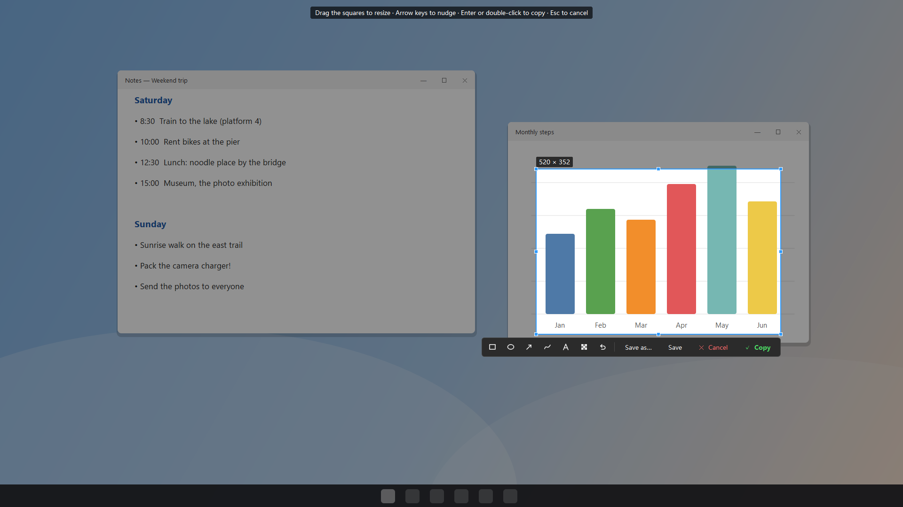
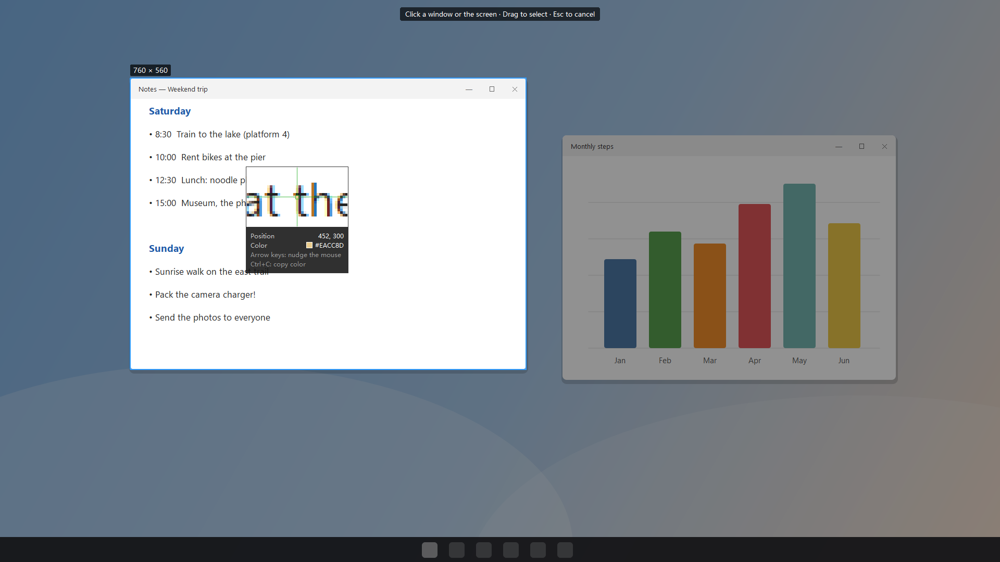
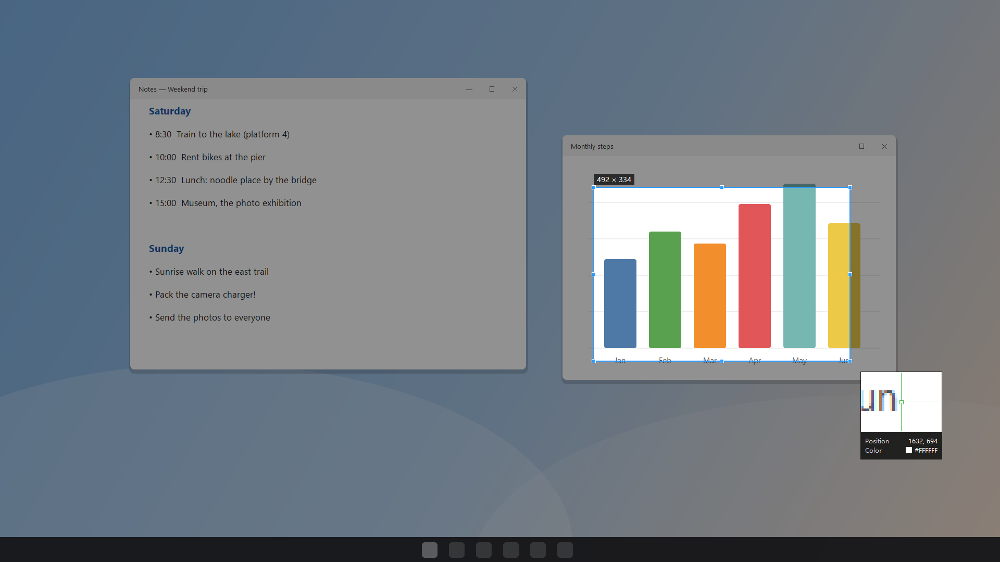
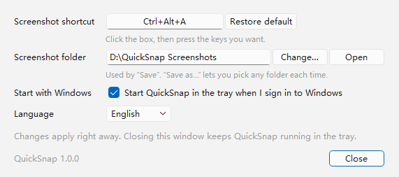

<div align="center">

# QuickSnap

**One shortcut, and your screenshot is on the clipboard.**

Windows tray app · window / full-screen / area capture · pixel magnifier · multi-monitor & high-DPI

[中文说明](README_cn.md) · [Download](https://github.com/skychenqianhang-hub/QuickSnap/releases/latest)

</div>



## Features

- **One shortcut for everything** (default `Ctrl+Alt+A`, works while QuickSnap sits in the tray). The screen dims and you choose:
  - **hover** a window — it lights up; **click** to take it (click the empty desktop for the whole screen);
  - **drag** to draw your own box.
- **Adjust before you keep it** — drag the 8 small squares to resize, drag inside to move, arrow keys nudge it 1 px (`Shift` = 10 px).
- **Copy / Save / Save as… / Cancel** — every option except Cancel also puts the picture on the clipboard, ready to paste into a chat or a document. `Enter` or double-click = copy, `Ctrl+S` = save, `Esc` = cancel.
- **Pixel magnifier** next to the pointer: 5× zoom with a crosshair on the exact pixel, its position and `#RRGGBB` colour. `Ctrl+C` copies the colour; arrow keys move the pointer one pixel at a time.
- **Accurate on multiple monitors and with 125% / 150% scaling** — boxes are measured in real screen pixels, so the saved picture is sharp and exactly where you pointed.
- **Settings**: change the shortcut (with a check for combinations other programs already use), the screenshot folder, start with Windows, and the language (English / 简体中文 / 日本語).

| Hover a window | Drag a box |
|---|---|
|  |  |

## Install

1. Download `QuickSnap-Setup-x.y.z.exe` (about 20 MB) from [Releases](https://github.com/skychenqianhang-hub/QuickSnap/releases/latest) and run it. Windows may warn about an unknown publisher (the installer is not code-signed): choose "More info → Run anyway".
2. The installer asks where screenshots should be saved (a drive other than the system drive is suggested when you have one) and whether QuickSnap should start when you sign in.
3. QuickSnap appears in the tray (bottom-right of the screen). Press `Ctrl+Alt+A`.

No administrator rights needed — it installs for the current user only. Requires Windows 10 / 11 (64-bit).

## Usage

| Where | What |
|---|---|
| `Ctrl+Alt+A` | Start a screenshot (change it in Settings) |
| Left-click the tray icon | Start a screenshot |
| Right-click the tray icon | Settings…, Open screenshot folder, Language, Quit |
| Start `QuickSnap.exe` again | Opens the Settings window of the running copy |



Files are named `QuickSnap_2026-11-07_13-25-30.png` (date and time; `_2`, `_3`… if taken within the same second). Settings live in `%APPDATA%\QuickSnap\config.json`; next to it, `timing.log` records how many milliseconds each screenshot step took (times only, no picture content; it stays under about 100 KB) to help find slow starts. Uninstalling (Windows Settings → Apps) keeps your screenshots and settings.

QuickSnap only uses public Windows interfaces: a registered global hotkey (no keyboard hook) and a normal screen copy. It never reads other programs' memory.

## Build from source

```bash
pip install -r requirements.txt          # Python 3.11
python main.py                           # run from source
python -m tests.test_core                # automatic tests
python -m PyInstaller --noconfirm --clean QuickSnap.spec   # -> dist\QuickSnap\QuickSnap.exe
dist\QuickSnap\QuickSnap.exe --check result.txt            # self-check, last line "ALL PASSED"
python installer/build_installer.py      # tests + build + self-check + installer (needs Inno Setup 6)
```

## License

[MIT](LICENSE).

## Credits

[PySide6](https://doc.qt.io/qtforpython/) · [PyInstaller](https://pyinstaller.org/) · [Inno Setup](https://jrsoftware.org/isinfo.php). Built with help from [Claude Code](https://claude.com/claude-code).
