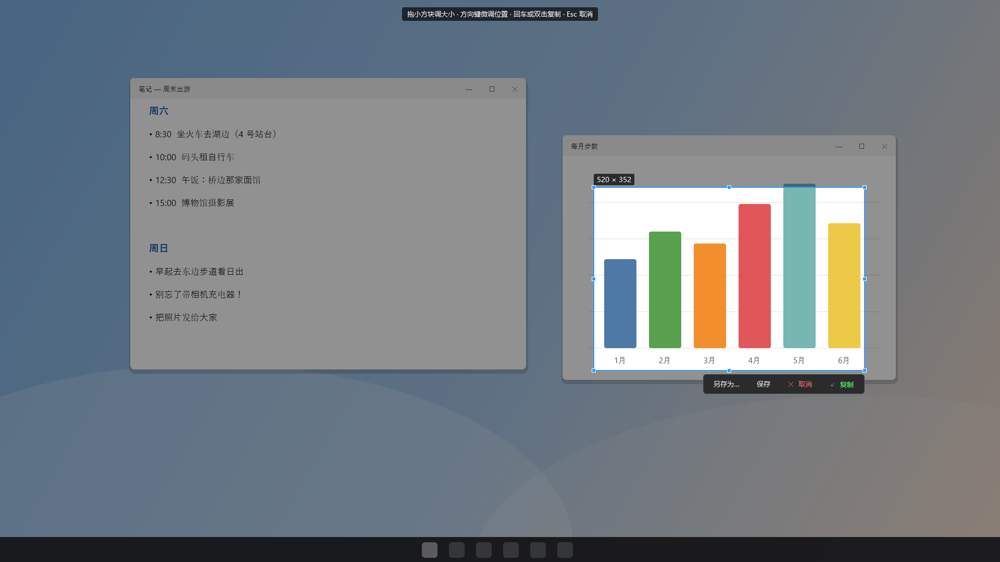
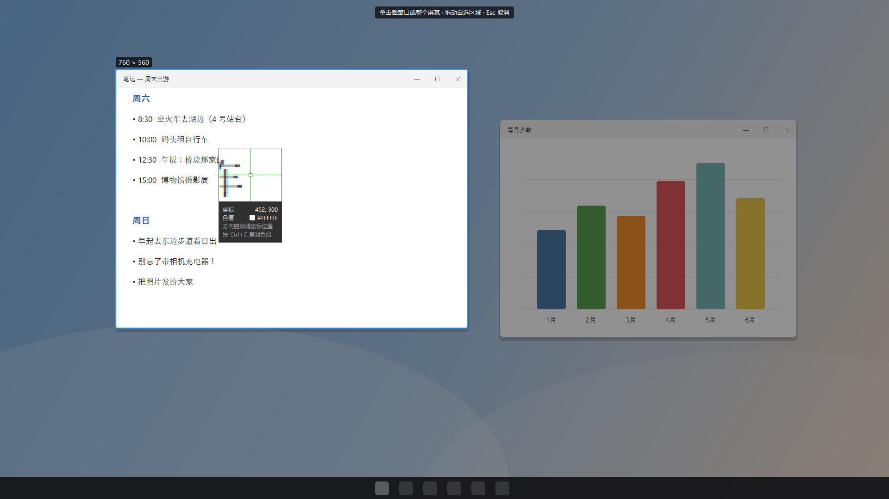
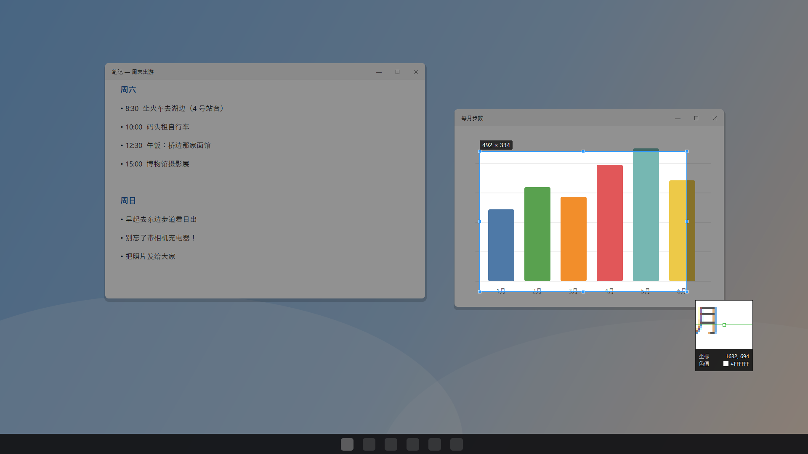
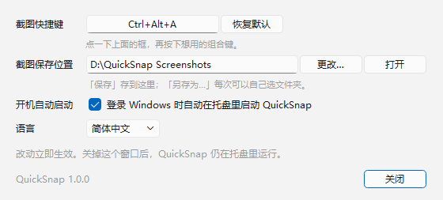

<div align="center">

# 快截 QuickSnap

**按一下快捷键，截图就在剪贴板里了。**

Windows 托盘小工具 · 窗口 / 全屏 / 自选区域截图 · 像素放大镜 · 多显示器和高分屏

[English](README.md) · [下载](https://github.com/skychenqianhang-hub/QuickSnap/releases/latest)

</div>



## 功能

- **一个快捷键搞定**（默认 `Ctrl+Alt+A`，程序在托盘后台也能用）。按下后屏幕变暗：
  - **鼠标停在窗口上**，窗口会亮起来，**单击**就截这个窗口（点在空桌面上 = 截整个屏幕）；
  - **拖动鼠标**，自己框一块区域。
- **选好后还能调整**：拖框上的 8 个小方块调大小，在框里拖动整体移动，方向键每次挪 1 个像素（按住 `Shift` 每次 10 个）。
- **复制 / 保存 / 另存为 / 取消**：除了取消，其余都会顺便复制到剪贴板，直接粘贴到聊天窗口或文档里就行。回车或双击 = 复制，`Ctrl+S` = 保存，`Esc` = 取消。
- **像素放大镜**：跟在鼠标旁边，放大 5 倍，绿色十字对准鼠标所在的那个像素，显示坐标和色值 `#RRGGBB`。`Ctrl+C` 复制色值，方向键逐像素移动鼠标。
- **多显示器、125% / 150% 缩放下也准**：选框按屏幕真实像素计算，截出来的图清晰，位置和你框的一模一样。
- **设置**：改快捷键（会检查是不是已经被别的程序占用）、截图保存位置、开机自动启动、界面语言（English / 简体中文 / 日本語）。

| 鼠标停在窗口上 | 拖动框选 |
|---|---|
|  |  |

## 安装

1. 在 [Releases](https://github.com/skychenqianhang-hub/QuickSnap/releases/latest) 下载 `QuickSnap-Setup-x.y.z.exe` 并运行。安装包没有数字签名，Windows 可能提示「未知发布者」，点「更多信息 → 仍要运行」。
2. 安装时会问截图存到哪里（有 C 盘以外的硬盘时，默认推荐存在那里），以及登录 Windows 时是否自动启动。
3. 装好后 QuickSnap 出现在托盘里（屏幕右下角），按 `Ctrl+Alt+A` 就能截图。

不需要管理员权限，只给当前用户安装。系统要求 Windows 10 / 11（64 位）。

## 使用

| 操作 | 作用 |
|---|---|
| `Ctrl+Alt+A` | 开始截图（可在设置里修改） |
| 左键单击托盘图标 | 开始截图 |
| 右键单击托盘图标 | 设置…、打开截图文件夹、语言、退出 |
| 程序开着时再双击 `QuickSnap.exe` | 打开设置窗口 |



截图文件名是 `QuickSnap_2026-11-07_13-25-30.png`（日期和时间；同一秒内截多张会加 `_2`、`_3`……）。设置保存在 `%APPDATA%\QuickSnap\config.json`。卸载（Windows 设置 → 应用）不会删除你的截图和设置。

QuickSnap 只用 Windows 公开的接口：注册全局快捷键（不装键盘钩子）和普通的屏幕复制，不读取其他程序的内存。

## 从源码构建

```bash
pip install -r requirements.txt          # Python 3.11
python main.py                           # 从源码运行
python -m tests.test_core                # 自动测试
python -m PyInstaller --noconfirm --clean QuickSnap.spec   # -> dist\QuickSnap\QuickSnap.exe
dist\QuickSnap\QuickSnap.exe --check result.txt            # 自检，最后一行是 "ALL PASSED"
python installer/build_installer.py      # 测试 + 打包 + 自检 + 安装包（需要 Inno Setup 6）
```

## 许可证

[MIT](LICENSE)。

## 致谢

[PySide6](https://doc.qt.io/qtforpython/) · [PyInstaller](https://pyinstaller.org/) · [Inno Setup](https://jrsoftware.org/isinfo.php)。在 [Claude Code](https://claude.com/claude-code) 的帮助下完成。
